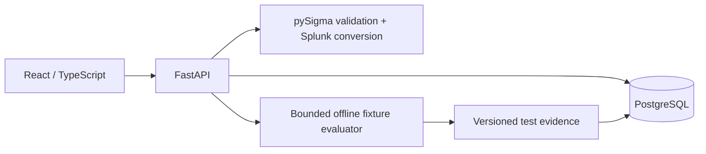
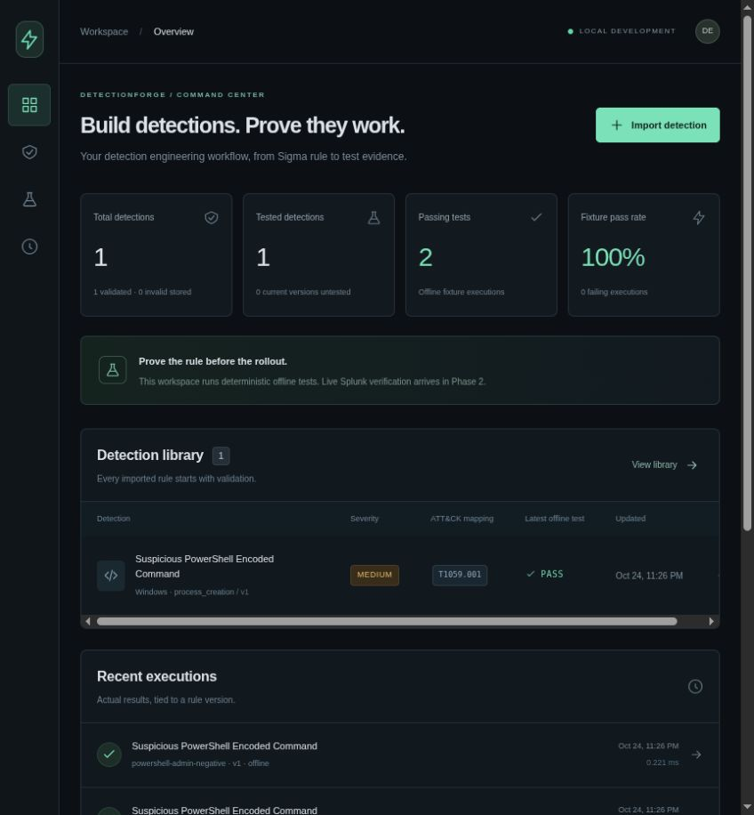

# DetectionForge

**Build detections. Prove they work.**

DetectionForge is a local Detection-as-Code workbench for Sigma rules. Import a rule, validate it with pySigma, inspect real generated Splunk SPL, and evaluate deterministic security-event fixtures. Test evidence is tied to immutable rule versions and includes exact expected/actual event IDs.

**Status: Phase 1 MVP.** Splunk execution, ingestion, ATT&CK catalog validation/coverage, correlation rules, authentication, and CI/CD are not implemented. Offline passes are fixture evidence, not proof of live detection effectiveness. The full product definition of done remains future work.

## Implemented

- Safe bounded Sigma YAML import, validation, search, severity filtering, editing, enable/disable, optimistic version checks, immutable YAML history.
- pySigma 1.5.1 with Splunk backend 2.1.0; Windows Sysmon process-creation SPL preview and environment-configured field mappings. Other source profiles fail explicitly.
- PowerShell encoded-command scenario with positive and benign synthetic event datasets.
- Explicit offline AST evaluation for a limited Sigma subset; unsupported constructs fail closed.
- Persisted runs and downloadable JSON reports with source YAML, dataset snapshot, expected/actual matches, failures, runtime, TP/FP/TN/FN, precision, and recall. Undefined values are null.
- Responsive React/TypeScript/Tailwind interface: overview, library, editor, testing center, execution history.
- SQLAlchemy model, PostgreSQL deployment, Alembic migration, optional SQLite local mode.

## Start locally

Run commands from the repository root. Use a system Python installation, not Splunk's embedded Python.

```bash
/usr/bin/python3 -m venv .venv
.venv/bin/python -m pip install -r backend/requirements.txt
cp .env.example .env
.venv/bin/alembic -c backend/alembic.ini upgrade head
.venv/bin/uvicorn app.main:app --app-dir backend --host 127.0.0.1 --port 8000
```

In a second terminal:

```bash
npm ci --prefix frontend
npm run dev --prefix frontend
```

Open [the web application](http://127.0.0.1:5173) and [API documentation](http://127.0.0.1:8000/docs). SQLite is an explicit convenience default; use PostgreSQL with Compose for the deployment configuration. See [installation](docs/INSTALLATION.md).

## PostgreSQL / Docker Compose

Copy `.env.example` to `.env`, replace `POSTGRES_PASSWORD` with a local password, then:

```bash
docker compose up --build -d
```

Open [DetectionForge on port 8080](http://127.0.0.1:8080). Compose runs PostgreSQL, FastAPI, and nginx; it reuses no Splunk resources and starts no Splunk container. Passwords pass through the environment, and the backend connection uses `PGPASSWORD`. The native `DATABASE_URL` in `.env` is deliberately overridden for the container backend. Stop using `docker compose down`; keep the named database volume to retain evidence.

## First detection test

1. Select **Import detection → Load PowerShell example → Validate → Generate SPL → Import rule**.
2. Close the editor and open **Testing center**.
3. Select the imported rule and `powershell-encoded-positive`. Execute the offline test. The expected IDs are `ps-encoded` and `ps-short-switch`.
4. Run `powershell-admin-negative`. It expects no matches.
5. Inspect the results and download a JSON report. All displayed results come from actual execution; a new database has zero rules and no runs.

The encoded sample contains inert text and is never executed. The suspicious pattern can also occur in legitimate administration. See [testing methodology and limitations](docs/DETECTION_TESTING.md).

## Verification

```bash
.venv/bin/pytest -c backend/pyproject.toml backend/tests -q
.venv/bin/ruff check backend scripts
.venv/bin/python scripts/check_offline.py
npm run build --prefix frontend
```

The offline script writes `reports/offline-report.json`; invalid rules or failed expectations exit nonzero. It does not modify the application database. See [verification evidence](docs/VERIFICATION.md) for checks actually performed in this workspace.

## Architecture



The backend does not execute generated queries. The future Splunk connector will use a dedicated index and per-run event isolation. No local Splunk configuration is changed by this MVP.

## ATT&CK and scope

The included rule maps to `T1059.001` (PowerShell). Phase 1 extracts technique tags and checks dataset/rule tag consistency. It does not claim authoritative ATT&CK validation or technique coverage. The roadmap adds live Splunk verification, authentication brute-force correlation, scheduled-task creation, official ATT&CK data, coverage states, and GitHub Actions in later phases.

## Documentation

- [Architecture and database decisions](docs/ARCHITECTURE.md)
- [Implementation roadmap](docs/ROADMAP.md)
- [Installation](docs/INSTALLATION.md)
- [Splunk integration plan](docs/SPLUNK_INTEGRATION.md)
- [Detection testing](docs/DETECTION_TESTING.md)
- [Dependency choices](docs/DEPENDENCIES.md)
- [Contributing](CONTRIBUTING.md)



Captured from the running PostgreSQL-backed application after executing the positive and benign fixtures. These are offline results, not live Splunk verification.

Licensed under MIT. Third-party dependencies retain their own licenses, including pySigma and the Splunk backend (LGPL-2.1).
